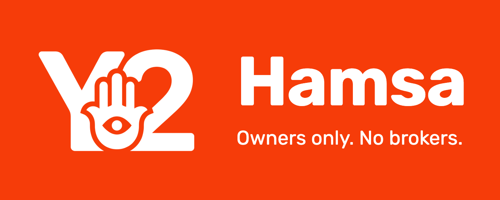
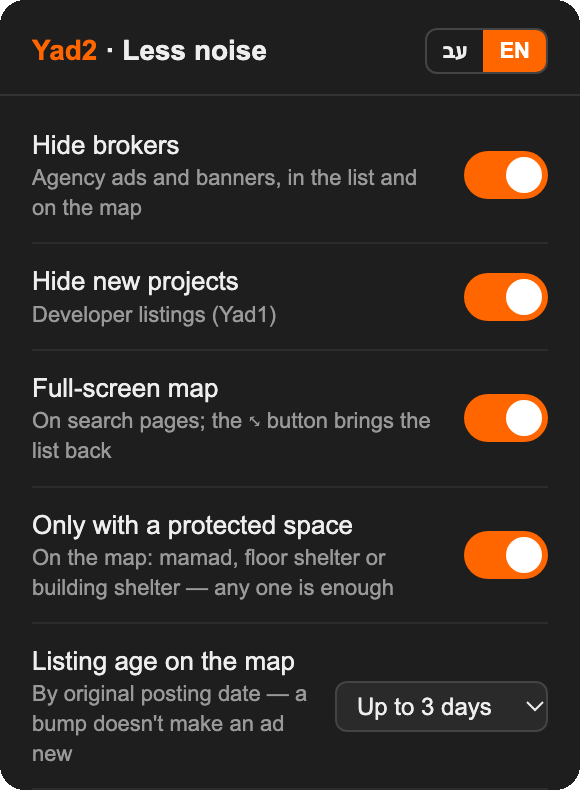
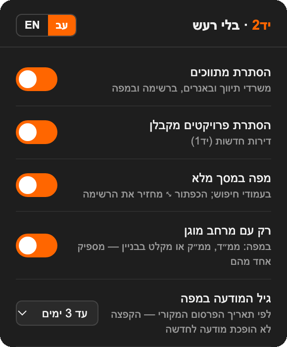

<p align="center">
  
</p>

# Hide brokers on Yad2 real estate

A Chrome extension for [yad2.co.il](https://www.yad2.co.il) that leaves only private owners and landlords in the real-estate feed and on the map.

**[Install from the Chrome Web Store](https://chromewebstore.google.com/detail/hide-brokers-on-yad2-real/edoljogdahibggfbjidicllgnjjggiod)** · [עברית](#עברית)

## Features

- **Hide brokers.** Removes real-estate agency listings and their banners from the feed and the map.
- **Hide new projects.** Removes developer listings and promotions (Yad1).
- **Full-screen map.** Stretches the map over the search page; the ⤡ button brings the list back.
- **Only with a protected space.** On the map, shows only apartments with a mamad, a floor shelter or a building shelter. Any one of them is enough, while Yad2's own filter requires all of them at once.
- **Listing age on the map.** Hides markers first published more than a day, 3 days, a week, 2 weeks or a month ago. A bump doesn't make an old listing new.
- Hebrew and English interface. The popup also shows how many ads were hidden on the current page.

Changes apply to the list right away. The map picks them up on the next pan or zoom, or after a page reload.

<p align="center">
  
</p>

## Install

**From the Chrome Web Store** (updates automatically): [Hide brokers on Yad2 real estate](https://chromewebstore.google.com/detail/hide-brokers-on-yad2-real/edoljogdahibggfbjidicllgnjjggiod).

**From source:**

1. Get the code: `Code → Download ZIP` and unzip, or `git clone`.
2. Open `chrome://extensions` and turn on **Developer mode**.
3. Click **Load unpacked** and select the `Y2-Hamsa` folder.
4. Reload the Yad2 tab.

Each [release](https://github.com/vlnchk/yad2-hamsa/releases) also has the packaged ZIP: unzip it into a folder and load that folder the same way.

## How it works

**Feed.** Yad2 marks every card in the feed with a `data-testid` on its `<li>`, and the value matches the ad type that Yad2's API returns. Detection relies on this markup, not on guessing from the ad text:

| Card | `data-testid` | Hidden by |
| --- | --- | --- |
| Private | `item-basic` | never |
| Broker | `agency-item`, `platinum-item`, `booster-item` | Hide brokers |
| Promoted agencies | `king-item`, `king-of-the-har-item`, `trio-list`, `leading-agencies` | Hide brokers |
| Developer project | `yad1-*`, `gray-project-feed-item` | Hide new projects |

The hiding is plain CSS keyed to a class on `<html>`, so ads don't flash on page load and the switches work without a reload. A `MutationObserver` picks up cards added by infinite scroll and page navigation.

**Map.** `map-filter.js` runs in the page context (`"world": "MAIN"`) and rewrites the response of `gw.yad2.co.il/realestate-feed/<rent|forsale>/map` before the map reads it:

- Hide brokers drops markers with `adType: "commercial"` and the `agencyPromotions`.
- Hide new projects drops `yad1Markers`, `yad1Promotions` and `grayMarkers`.
- Only with a protected space replaces the request with three (`shelter=1`, `floorShelter=1`, `buildingShelter=1`) and merges the answers without duplicates, which turns Yad2's AND into OR.
- Listing age uses `dates.approvedAt`. Yad2 doesn't send it for every marker, so otherwise the extension takes the upload time of the earliest photo, which is part of the image URL (`.../y2_1pa_010371_20261022191850.jpeg`). A bump changes neither. Markers with no date and no photos are kept.

**Full-screen map.** Yad2's class names are hashed CSS modules that change between deploys, so `map-fullscreen.js` finds the map column from Mapbox's stable `.mapboxgl-map` container, climbing up through ancestors of the same width.

## Limitations

- Yad2 returns up to about 200 markers for the visible map area. The filters remove markers from what came back and don't load more, so zoom in for full coverage.
- The numbers in neighborhood bubbles count all listings: the server sends only a total, with no private/broker split. With "Only with a protected space" they are summed over three requests, so a listing with several kinds of shelter is counted more than once.
- The protected-space and listing-age filters work on the map only, not in the list.
- Listing dates are in Israel time and are compared with the browser clock.
- Yad2 can change its markup or API at any time, and detection may break until the extension is updated.

## Privacy

The extension runs only on `yad2.co.il`. It has no servers, accounts, analytics or remote code. The only network requests it makes are Yad2's own map requests, with the shelter parameter changed. The one permission besides site access is `storage`, which keeps your settings in Chrome sync storage.

## Project structure

```
Y2-Hamsa/                 the extension (Manifest V3, no build step)
  manifest.json
  content.js, hide.css    feed: finds broker and project cards, hides them, counts them
  map-filter.js           map: rewrites Yad2's map responses in the page context
  shelter-setting.js      pass the map settings from storage to the page context
  age-setting.js
  map-fullscreen.js       full-screen map and its button
  popup.html, popup.js    popup
  i18n.js                 Hebrew and English strings
  _locales/               extension name and description for Chrome
  icons/
docs/                     images for this README
```

To try a change, press ↻ on the extension card in `chrome://extensions` and reload the Yad2 tab. Before publishing a new version, bump `version` in `manifest.json` and keep `extDesc` in `_locales/*/messages.json` within 132 characters, the Chrome Web Store limit.

## Credits

Based on [Elimeshi1/yad2-hide-agencies](https://github.com/Elimeshi1/yad2-hide-agencies) (MIT). This version adds the map filters, the full-screen map and the English interface, and works with real estate only: car dealers are no longer hidden.

Not affiliated with Yad2.

## License

[MIT](LICENSE)

---

<div dir="rtl">

## עברית

תוסף Chrome שמשאיר בפיד הנדל״ן ובמפה של יד2 רק מודעות של בעלים ומשכירים פרטיים.

- **הסתרת מתווכים** — מודעות של משרדי תיווך והבאנרים שלהם נעלמים מהרשימה ומהמפה.
- **הסתרת פרויקטים מקבלן** — מודעות ומבצעים של יד1 מוסתרים.
- **מפה במסך מלא** — המפה נמתחת על כל המסך, ובלחיצה אחת חוזרים לרשימה.
- **רק עם מרחב מוגן** — במפה מוצגות רק דירות עם ממ״ד, ממ״ק או מקלט בבניין, ומספיק אחד מהם (הסינון של יד2 דורש את כולם יחד).
- **גיל המודעה במפה** — מסתיר במפה מודעות שפורסמו לפני יותר מיום, 3 ימים, שבוע, שבועיים או חודש. הקפצה לא הופכת מודעה ישנה לחדשה.
- ממשק בעברית ובאנגלית.

<p align="center">
  
</p>

### התקנה

**מחנות Chrome** (מתעדכן אוטומטית): [Hide brokers on Yad2 real estate](https://chromewebstore.google.com/detail/hide-brokers-on-yad2-real/edoljogdahibggfbjidicllgnjjggiod)

**מהקוד:**

1. הורידו את הקוד (`Code ← Download ZIP` וחילוץ, או `git clone`)
2. פתחו `chrome://extensions` והפעילו **מצב מפתח** (Developer mode)
3. **טען תוסף לא ארוז** (Load unpacked) ← בחרו את התיקייה `Y2-Hamsa`
4. רעננו את הלשונית של יד2

הכול רץ מקומית בדפדפן: בלי חשבון, בלי מעקב, ושום מידע לא נשלח לשום מקום. ההגדרות נשמרות בסנכרון של Chrome.

התוסף אינו קשור ליד2. מבוסס על [Elimeshi1/yad2-hide-agencies](https://github.com/Elimeshi1/yad2-hide-agencies) (רישיון MIT).

</div>
